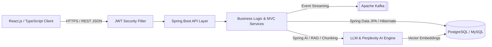

<div align="center">

# ⚡ Akash Lawande
### **Backend-Focused Software Engineer — Java • Spring Boot • Microservices • Applied AI**

📍 **Maharashtra, India** &nbsp;|&nbsp; 🟢 **Immediate Joiner (Office / Remote / Hybrid)** &nbsp;|&nbsp; 🎓 **B.E. Computer Engineering (8.55 CGPA)**

<p align="center">
  <a href="https://www.linkedin.com/in/akash-lawande0852/" target="_blank">
    
  </a>
  <a href="https://leetcode.com/u/akashlawande" target="_blank">
    
  </a>
  <a href="mailto:akashlawande852@gmail.com">
    
  </a>
  <a href="https://github.com/akaza8" target="_blank">
    
  </a>
</p>

</div>

---

## 🧠 Backend Engineering Profile & Production Impact

<table>
  <tr>
    <td width="58%" valign="top">

```yaml
engineer:
  name: "Akash Lawande"
  role: "Software Engineer (Backend & Full-Stack)"
  experience: "8 Months Production @ Netwin Infosolutions"
  core_focus:
    - "High-Throughput RESTful APIs & Spring Boot Microservices"
    - "Database Schema Design & Query Optimization (PostgreSQL / MySQL)"
    - "Applied AI, RAG Pipelines, Vector Embeddings & Spring AI"
    - "Legacy Modernization (Angular -> React.js + Spring Boot)"
  problem_solving: "200+ DSA Problems Solved on LeetCode (Java)"
  status: "Immediate Joiner | Open to Backend & Full-Stack Roles"
```

</td>
    <td width="42%" valign="top">
      <h4>⚡ Production Benchmarks (Netwin Infosolutions)</h4>
      <table>
        <tr>
          <td align="center" width="50%">
            <h3><b>-40%</b></h3>
            <sub><b>Response Latency</b><br/>ServiceNow Chatbot Automation</sub>
          </td>
          <td align="center" width="50%">
            <h3><b>-30%</b></h3>
            <sub><b>Page Load Time</b><br/>Angular to React + Spring Boot</sub>
          </td>
        </tr>
        <tr>
          <td align="center" width="50%">
            <h3><b>+25%</b></h3>
            <sub><b>System Scalability</b><br/>Spring Boot DIP &amp; SQL Tuning</sub>
          </td>
          <td align="center" width="50%">
            <h3><b>200+</b></h3>
            <sub><b>DSA Problems</b><br/>Solved on LeetCode</sub>
          </td>
        </tr>
      </table>
    </td>
  </tr>
</table>

---

## 🏗️ How I Architect Backend & AI Systems



---

## 🛠️ Technical Arsenal

<div align="center">
  
</div>

<br/>

<table width="100%">
  <tr>
    <td width="25%" valign="top">
      <h4>⚙️ Backend &amp; APIs</h4>
      <p>
        
        
        
        
        
        
        
        
      </p>
    </td>
    <td width="25%" valign="top">
      <h4>🗄️ Databases &amp; Messaging</h4>
      <p>
        
        
        
        
        
        
      </p>
    </td>
    <td width="25%" valign="top">
      <h4>🤖 Applied AI &amp; LLM Stack</h4>
      <p>
        
        
        
        
        
      </p>
    </td>
    <td width="25%" valign="top">
      <h4>🐳 DevOps, Testing &amp; Web</h4>
      <p>
        
        
        
        
        
        
        
        
      </p>
    </td>
  </tr>
</table>

---

## 🚀 Featured Engineering Systems

<table>
  <tr>
    <td width="50%" valign="top">
      <h3>1. <a href="https://github.com/akaza8/ai-rfp-system">AI-Powered RFP &amp; Procurement Engine</a></h3>
      <p>
        <code>Spring Boot</code> • <code>PostgreSQL</code> • <code>Docker</code> • <code>Perplexity AI</code> • <code>React + TypeScript</code>
      </p>
      <ul>
        <li><b>Backend Architecture:</b> Engineered a RESTful Spring Boot backend with containerized PostgreSQL persistence to automate enterprise Request for Proposal (RFP) creation and vendor lifecycle tracking.</li>
        <li><b>AI Email &amp; Document Parser:</b> Integrated <b>Perplexity AI</b> pipelines to ingest unstructured vendor email responses and transform them into structured, queryable proposal schemas.</li>
      </ul>
      <p><a href="https://github.com/akaza8/ai-rfp-system"><b>→ View Source &amp; Architecture on GitHub</b></a></p>
    </td>
    <td width="50%" valign="top">
      <h3>2. <a href="https://github.com/akaza8/quiz-app">Quiz Management System — REST API</a></h3>
      <p>
        <code>Java</code> • <code>Spring Boot</code> • <code>Spring Data JPA</code> • <code>MySQL</code> • <code>MVC Architecture</code>
      </p>
      <ul>
        <li><b>Layered Backend Service:</b> Designed a modular REST API separating <code>Controller</code>, <code>Service</code>, and <code>DAO/Repository</code> layers for question bank management and dynamic quiz assembly.</li>
        <li><b>Automated Evaluation Engine:</b> Built server-side scoring logic and custom JPA native queries to generate randomized category quizzes and evaluate submissions securely.</li>
      </ul>
      <p><a href="https://github.com/akaza8/quiz-app"><b>→ View Source &amp; API Spec on GitHub</b></a></p>
    </td>
  </tr>
</table>

---

## 💼 Production Engineering Experience

### **Junior Software Engineer** — Netwin Infosolutions
<kbd>Aug 2024 – Mar 2025</kbd> &nbsp;•&nbsp; 📍 *Nashik, India*

- **Data Integration Platform (DIP) Backend:** Architected, developed, and deployed RESTful APIs using **Spring Boot, Spring MVC, and stateless JWT authentication**, applying SQL indexing and query optimization to improve platform scalability by **25%**.
- **Legacy Angular → React.js + Spring Boot Migration:** Led the end-to-end modernization of a legacy Angular application to a decoupled **React.js frontend and Spring Boot REST backend**, reducing page load times by **30%**.
- **ServiceNow Chatbot Platform Integration:** Engineered and integrated automated ServiceNow conversational workflows across multiple client web portals, cutting average customer inquiry response time by **40%**.
- **Multilingual CMS & E-Commerce Modules:** Delivered multilingual content management features across **5+ languages** for the **Chiesi BE CMS** (`Laravel PHP`, `jQuery`) and built a real-time interactive product **Logo Placement engine** (`JavaScript`) for **Fireman-Locker**.

---

## 📈 Problem Solving & Coding Activity

<div align="center">
  <a href="https://leetcode.com/u/akashlawande">
    
  </a>
</div>

---

## 🎓 Education & Verified Credentials

| Credential / Degree | Institution / Issuer | Highlights / Verification |
| :--- | :--- | :--- |
| **B.E. in Computer Engineering** | Amrutvahini College of Engineering (SPPU) | **CGPA: 8.55 / 10.0** *(2020 – 2024)* |
| **AWS Cloud Technical Essentials** | Coursera / AWS | [Verify Certificate ↗](https://www.coursera.org/account/accomplishments/records/GYG27W3P12WD) |
| **AWS Cloud Computing Virtual Internship** | Eduskill Foundation | [Verify Certificate ↗](https://drive.google.com/file/d/17eZcAIyzMpRxetSyISmg8YiZCXMYbREj/view) |
| **Python for Data Science** | NPTEL | [Verify Certificate ↗](https://drive.google.com/file/d/1txoINe-Poe7E-gtqu46Nwt-MtVi4HI1e/view) |
| **LeetCode Problem Solving Badge** | LeetCode | [200+ DSA Problems Solved ↗](https://leetcode.com/u/akashlawande) |
